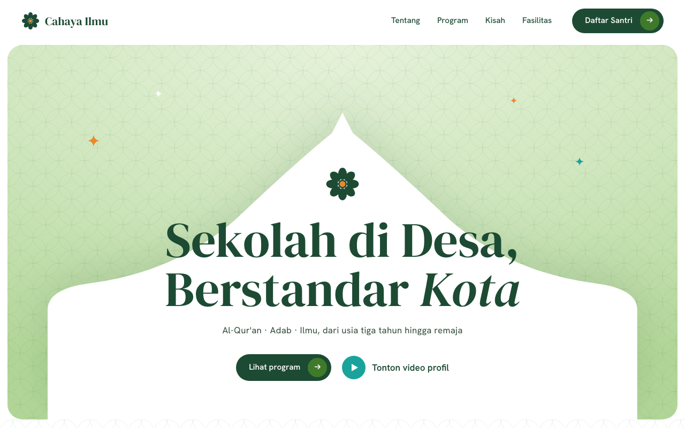

# Template Sekolah & Yayasan Qur'ani

Template website premium untuk yayasan, TK Qur'an, madrasah, dan SD Islam: kubah animasi GSAP, jadwal salat otomatis, satu config.js.

Tier: **premium** · Kategori: Template Website



## Fitur

- Hero kubah beranimasi GSAP
- Semua brand & kontak di config.js
- Jadwal salat otomatis sesuai kota
- Angka statistik berhitung saat digulir
- Kartu program bingkai mihrab
- Linimasa kisah lembaga
- Tombol WhatsApp PPDB
- Responsif + menu HP
- Ilustrasi SVG tanpa foto

## Cara menjalankan

1. Unduh atau clone folder ini.
2. Klik dua kali `index.html` — langsung terbuka di browser (butuh internet untuk font & GSAP dari CDN).
3. Edit teks dengan editor apa pun (mis. VS Code), simpan, lalu muat ulang browser.
4. Untuk online: unggah seluruh folder ke GitHub Pages, Netlify, atau Vercel.

## Struktur folder

```
index.html   halaman utama
config.js    SEMUA teks brand, kontak, kota, angka
style.css    tampilan & warna (:root)
app.js       animasi GSAP, jadwal salat, menu
meta.json, README.md, LICENSE, ss.png
```

## Cara ubah brand & warna

Buka `config.js`: nama yayasan, alamat, WA, email, Instagram, kota (untuk jadwal salat), dan angka statistik ada di satu tempat. Warna ada di `style.css` bagian `:root` (`--g-900` hijau tua, `--orange`, `--teal`). Ilustrasi pengganti foto memakai kelas `.ph`; ganti dengan `` foto Anda bila perlu.

## Ganti logo & foto

Semua path gambar ada di **`config.js`** (bagian `LOGO & FOTO`). Placeholder berlabel ada di folder `img/`; ganti dengan **menimpa berkas bernama sama** atau **ubah path**-nya.

| Slot | Kunci di `config.js` | Placeholder | Rasio |
|---|---|---|---|
| Logo navbar, footer, favicon | `logo` (kosong = ornamen bunga) | `img/logo.svg` | 1:1 |
| Latar hero | `foto.hero` | – | 16:9 |
| Tentang, gedung, lingkaran angka | `foto.tentang`, `foto.gedung`, `foto.halaman` | – | 4:5, 4:3, 1:1 |
| 4 kartu program | `foto.program[0..3]` | – | 3:4 |
| 3 kubah fasilitas | `foto.fasilitas[0..2]` | – | 3:4 |
| Latar ajakan daftar | `foto.cta` | – | 16:9 |
| Guru & staf (nama, peran, foto) | `guru[]` | `img/guru-1..3.svg` | 4:5 |
| Galeri kegiatan | `galeri[]` | `img/galeri-1..4.svg` | 4:3 |

Slot yang kosong tetap memakai ilustrasi SVG bawaan. Foto yang gagal dimuat otomatis kembali ke ilustrasi; logo yang gagal diganti inisial nama. Kosongkan `guru` dan `galeri` untuk menyembunyikan bagian "Guru & galeri". Kompres foto (≤200 KB, lebar ≤1600 px).

## Kredit

Dibuat oleh Maliki Studio — malikisaputra.biz.id, follow TikTok/IG @malikisaputra

## Lisensi

Lisensi Nonkomersial Maliki Studio (lihat `LICENSE`): gratis dipakai untuk usaha/organisasi sendiri dan boleh diubah, **wajib mencantumkan kreator** (Template oleh Maliki Saputra, @malikisaputra), dan **tidak boleh diperjualbelikan** tanpa izin. Mau menjual atau kerja sama? Diskusikan dulu dengan kreatornya.

---

<!-- kredit-maliki -->
**Kredit:** Template oleh Maliki Saputra (@malikisaputra) — https://malikisaputra.biz.id. Kredit di footer & kepala berkas wajib dipertahankan (lihat LICENSE).

<!-- panduan-ai-maliki -->
## Ubah sendiri sesuai kebutuhanmu pakai AI

Kamu tidak perlu jago coding. Template ini sudah disiapkan supaya mudah diubah AI: ada **AGENTS.md** (aturan proyek untuk AI), **DESIGN.md** (gaya desain), dan skill Claude di folder `.claude/skills/`. Pilih salah satu cara di bawah.

### Cara 1: ChatGPT, Claude, atau Gemini di browser (paling gampang, gratis)
1. Unduh ZIP template ini, lalu ekstrak.
2. Buka chatgpt.com, claude.ai, atau gemini.google.com.
3. Unggah berkas yang mau diubah (biasanya `index.html`, `style.css`, `app.js`, atau berkas data). Unggah juga `AGENTS.md` dan `DESIGN.md` (kalau ada) biar AI paham aturannya. ChatGPT juga bisa menerima ZIP utuh.
4. Tulis permintaanmu (contoh di bawah), lalu minta: "Kirim ulang berkas yang diubah secara utuh."
5. Ganti berkas lama dengan hasil dari AI, lalu buka `index.html` di browser untuk cek.

### Cara 2: Claude Code (paling rapi untuk perubahan besar)
1. Pasang Claude Code (lihat claude.com/claude-code), atau pakai aplikasi Claude Desktop tab Code.
2. Buka folder template ini, lalu jalankan `claude` di terminal folder itu.
3. Tulis permintaanmu. Kalau ada folder `.claude/skills/ubah-…`, Claude Code otomatis memakainya, jadi hasilnya tetap mengikuti desain aslinya.

### Cara 3: Codex (OpenAI)
1. Pasang Codex CLI atau pakai Codex di aplikasi ChatGPT.
2. Buka folder template, jalankan `codex`. Codex otomatis membaca `AGENTS.md`.
3. Tulis permintaanmu, cek perubahannya, lalu setujui.

### Cara 4: Google Antigravity atau Gemini CLI (gratis)
1. Antigravity: buka aplikasinya, pilih **Open Folder** ke folder template ini, lalu tulis permintaan di panel agen.
2. Gemini CLI: jalankan `gemini` di folder template.
3. Di awal, tulis: "Baca AGENTS.md dan DESIGN.md dulu sebelum mengubah apa pun."

### Contoh permintaan yang bisa langsung kamu pakai
- "Ganti nama, logo teks, dan warna utama jadi hijau tua sesuai usahaku: [nama usaha]."
- "Tambahkan kolom [nama kolom] di formulir dan tampilkan di daftar."
- "Ubah semua data contoh jadi data usahaku: [tempel datanya]."
- "Tambahkan halaman/menu baru untuk [kebutuhan], gaya desainnya sama dengan yang sudah ada."
- "Jelaskan dulu cara kerja aplikasi ini dengan bahasa sederhana, baru ubah [bagian]."

### Tips biar hasilnya bagus
- Satu permintaan = satu perubahan. Cek dulu hasilnya, baru minta yang berikutnya.
- Simpan salinan folder asli sebelum mengubah, jadi bisa balik kalau ada yang rusak.
- Kalau ada error, salin pesan errornya (klik kanan > Inspect > Console) lalu tempel ke AI.
- Data aplikasi tersimpan di browser (localStorage). Backup dulu sebelum ganti versi.
- Jangan hapus kredit "Template oleh @malikisaputra", dan template ini **tidak boleh diperjualbelikan** tanpa izin. Mau menjual atau kerja sama? Diskusikan dulu dengan kreatornya (@malikisaputra).

Masih bingung? Komen di TikTok/IG **@malikisaputra**, nanti aku bantu.
